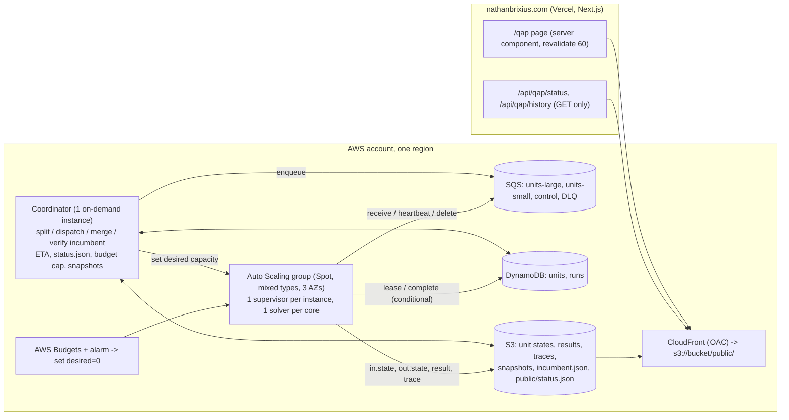

# A distributed branch-and-bound solver for the QAP on AWS: engineering plan

Status: proposal, 2026-10-31. Built from the solver in `latest/` (branch `cognac`)
and the multi-process runner `bench/parallel.py`. Everything marked *measured*
comes from a report in this repository (path given); everything marked
*estimated* is arithmetic on those measurements or a price list, and says so.

Contents

1. Summary
2. Work model
3. Orchestration options
4. Fault tolerance, checkpoint and restart
5. Incumbent policy
6. Tracing
7. Dashboard and wrapper API
8. Infrastructure as code and operations
9. Validation and reproducibility
10. Cost model
11. Phased plan with effort estimates
12. Risks and open questions

---

## 1. Summary

**Recommendation in ten lines.**

1. Keep the C++ solver (`latest/bnbdrv`) as the worker, unchanged in its
   arithmetic; add three small features: an incumbent file it re-reads at node
   boundaries, a per-node trace line, and per-depth DNN statistics.
2. The work unit is a *subtree with a CPU budget*, expressed as the solver's
   existing state file (`latest/state.h`, `QAP-STATE 3`): the solver resumes it
   (`-r`), runs until done or until the budget (`-t`), and writes its open nodes
   back (`-o`). This is exactly what `bench/parallel.py` does on one machine.
3. Orchestration: a single small **coordinator** process, an **SQS** queue of
   units, a **DynamoDB** ledger of units and run totals, and **S3** for unit
   state files, results, traces, snapshots and the dashboard document. Workers
   are an **EC2 Auto Scaling group of Spot instances** (several instance types,
   several AZs) running one solver process per physical core.
4. Fleet size is one number: the group's desired capacity. 10 cores and
   10,000 cores use the same code paths; nothing in the design has a per-node
   or per-core table in memory.
5. Spot interruptions are handled by the solver's own checkpointing (`-k`) and
   its stop-on-signal (SIGUSR1 → state file, exit 3); the worst case loses the
   CPU spent since the last checkpoint on the interrupted cores, about a minute.
6. Incumbents are verified by the coordinator (objective recomputed from the
   permutation), published as a versioned S3 object, and picked up by running
   workers within a minute. Late propagation is always safe.
7. Tracing has three levels; the per-node level costs nothing measurable on a
   100-second node and about 10 GB at 10^8 nodes.
8. The dashboard is a JSON status document written every minute to S3, served
   through CloudFront, and read by a Next.js server component on
   nathanbrixius.com with `revalidate: 60`. No write path from the website.
9. Terraform for the infrastructure; a multi-architecture container image with
   a pinned OpenBLAS build and a fixed `-march`, one CPU family per run.
10. Phases 0 to 5 (benchmark, one instance, 100 cores with induced
    interruptions, restart drills, tracing and dashboard, 1,000+ cores) cost
    under about $1,500 in AWS charges and about 25 to 40 engineering days; the
    wil50 attempt is a separate decision taken on the Phase-5 numbers.

**The fleet dial.** `desired_capacity` of one Auto Scaling group, in instances;
with 64-core instances, 1,000 cores is 16 instances and 10,000 cores is 157.
The coordinator also enforces a dollar cap and will set the dial to zero
itself.

**What a wil50 attempt costs at today's per-node cost** (*estimated*; inputs
from `experiments/wil50_feasibility/NOTES.md` sections 4, 7a and 9):

| quantity | low | high |
|---|---|---|
| DNN nodes | 4e7 | 1e8 |
| CPU per node, 2.8 GHz Xeon core | 100 s | 130 s |
| core-seconds | 4.0e9 | 1.3e10 |
| core-days | 46,300 | 150,500 |
| core-years | 127 | 412 |
| wall at 1,000 cores, 90% efficient | 51 days | 167 days |
| wall at 4,000 cores | 13 days | 42 days |
| wall at 10,000 cores | 5 days | 17 days |
| Graviton Spot, if one Graviton core does the work of one reference core ($0.010 to $0.015 per core-hour) | $11,000 | $54,000 |
| Graviton Spot, if a Graviton core is 1.5x slower | $17,000 | $81,000 |
| x86 Spot, one process per physical core ($0.022 to $0.045 per core-hour) | $24,000 | $163,000 |

Call it **$15,000 to $80,000 of compute, central case $20,000 to $50,000**,
plus $150 to $300 a month of fixed services. Phase 0 (which CPU) and Phase 5
(a sampling run that measures the tree) each narrow this by about 2x. For
comparison, Fujii et al. (arXiv:2101.09629, Table 5) estimate wil50 at
20.5 to 39.3 million nodes under their three branching rules and report that
their generated node counts run up to 3x the estimate; our 4e7 to 1e8 range
brackets the same thing.

**Phased path.** Phase 0 picks the CPU and builds the image (3 to 4 days).
Phase 1 runs nug30 end to end through the coordinator on one instance (5 to 8
days). Phase 2 runs 100 Spot cores with interruptions induced on purpose (4 to
6 days). Phase 3 drills pause, resume and restore (3 to 4 days). Phase 4 adds
tracing and the dashboard (5 to 8 days). Phase 5 runs 1,000+ cores on a tho40
or wil50 sampling run (3 to 5 days plus run time). Phase 6 is the wil50
attempt, if the numbers say so. Section 11 has deliverables and acceptance
tests for each.

**What carries over from the 2000 solve and what is different.** Anstreicher,
Brixius, Goux and Linderoth solved nug30 in June 2000 on a Condor pool with
the MW master-worker framework: an average of 653 workers over 6.9 days, a
tree of 1.19e10 nodes, about 7 years of a single HP C3000
(`docs/dnn_bound/dnn_bound.tex`, `experiments/nug30_solve/nug30_2000_levels.txt`).
The shape carries over whole: a master holding a pool of open nodes, workers
given deep subtrees with a time budget, unfinished nodes returned to the
master, incumbents broadcast, the master's pool checkpointed. The remnant of
that design is still in `latest/bnb.C` (`finishing_up`, `max_returned_depth`
under `#ifndef BNB_STANDALONE`); the standalone `-t`/SIGUSR1 stop is its
modern equivalent. What is different: a DNN node costs about 100 s instead of
about 1.5 ms (1.19e10 nodes in 7 CPU-years), a factor of 10^5. So a unit that
takes minutes to hours is 10 to 1,000 nodes rather than 10^6 to 10^8; the
fault-tolerance granularity is the node, not the subtree; the master's pool is
thousands of units, not millions of nodes; and tracing every node is
affordable. Workers are now rented, homogeneous and interrupted *with two
minutes' notice*, instead of donated cycles that vanished without one; the
master's state can live in managed services rather than one process's memory;
and every DNN bound is certified, so the proof can be audited node by node.

---

## 2. Work model

### 2.1 The unit

A **unit** is a set of open nodes of the search tree, a cutoff, and the
settings that decide how they are bounded and branched. Concretely it is:

- a `QAP-STATE 3` file (`latest/state.h`) holding the node lines
  (`depth, bound, predicted_bound, nfix, p[], history[], warm`), the
  Frank-Wolfe warm-start points of their parents, the incumbent, the root bound,
  and zeroed statistics (as `bench/parallel.py`'s `template.zero_stats()` does);
- a manifest (JSON) with the run id, unit id, parent unit, kind, the cutoff
  version at dispatch, the solver image digest, params file hash, `-x`
  settings, DNN environment variables, trace level, CPU budget, and attempt
  number.

The subproblem of a node is fully defined by the instance plus its fixed
assignments (`i:j,...` in `history` order, the same notation `dnntest -x`
takes), so the manifest's `root_spec` plus the instance are enough to rebuild
any node's problem for audit.

Node spec and manifest, for one unit of a wil50 run:

```json
{
  "run_id": "wil50-r1",
  "unit_id": "u0000123456",
  "parent_unit": "u0000000071",
  "kind": "solve",
  "root_spec": "26:27,8:38,34:28",
  "depth": 3,
  "nodes": 1,
  "state_key": "runs/wil50-r1/units/u0000123456/in.state",
  "cutoff_version": 1,
  "incumbent": 48816,
  "solver": {
    "image": "sha256:…",
    "git": "04a4cd3",
    "params": "PARAM/wil50_deep.par",
    "params_sha256": "…",
    "flags": "-x 3:7:1:300:1",
    "env": {"QAP_DNN_GAMMA1": "1", "QAP_DNN_GAMMA": "1",
            "QAP_DNN_CHEB": "3", "QAP_DNN_TIGHT_LAM": "2"}
  },
  "budget_cpu_s": 7200,
  "trace_level": 1,
  "attempt": 1
}
```

Three unit kinds, all the same solver invocation with different flags:

| kind | solver flags | returns |
|---|---|---|
| `expand` | `-r in.state -d D -o out.state` | the open nodes at depth D (the frontier below this node), statistics for depths < D |
| `solve` | `-r in.state -t B -k 60 -o out.state` | statistics; if the budget B was hit, the open nodes (exit code 3) |
| `estimate` | `-r in.state -e` or a `solve` with a small node set | node and CPU totals of sampled subtrees, for the ETA |

The optional parent DNN warm-start multiplier (`DNNWarm` in `latest/dnn.h`,
`-x ...:1`) is **not** carried across unit boundaries. It is
(m^2+1)^2 doubles, 39 MB at m = 47 (78 MB with the primal Y), and it is not in
the state file by design (`latest/assign.h`, `WarmStart::dnn`). Inside a unit
the warm start works as it does today. A node handed to another unit starts
cold, which costs 13 to 16% more DNN time at nug30 depths 3 and 4 (*measured*,
`experiments/nug30_solve/README.md`). `bench/parallel.py` already has this
property ("a node handed to another worker loses its parent's multiplier"),
and section 2.3 cuts units so that most parent-child pairs stay inside one.

### 2.2 Depth policy

The bound at each depth is a run parameter, recorded in every unit's
manifest. The wil50 setting that the reports support
(`experiments/eigensolver/README.md` sections 5 to 8,
`experiments/wil50_feasibility/tuning/README.md`,
`experiments/wil50_feasibility/solvers/accel/README.md`):

| depth | bound | why |
|---|---|---|
| 0 to 2 | QPB only (`PARAM/nug_deep.par` rules) | nothing fathoms there on wil50: the root DNN is about 680 short, depth 3 fathoms 12% (*measured*, NOTES.md section 2). The DNN at depth 2 would cost 612 nodes x about 10 minutes for information only; optional |
| 3 to 7 | QPB, then the DNN bound on QPB misses: `-x 3:7:1:300:1`, PRSM (`QAP_DNN_GAMMA1=1 QAP_DNN_GAMMA=1`), `QAP_DNN_CHEB=3 QAP_DNN_TIGHT_LAM=2`, give-up at 300 iterations (or `QAP_DNN_GAP_RATIO=0.65` with H = 150, once exposed in `-x`; see tuning/README.md: H = 200 has a thin margin, the gap-ratio rule has none of that risk) | depth 3 to 5 is where 95% of the work is; fathoming moves up about 130 units per level; `-x` to depth 7 avoids QPB subtrees under late misses (nug28: one depth-5 PRSM miss under `-x 2:5` cost 3.5 million QPB nodes) |
| 8 and below | QPB only, with nodes of 7 or fewer free facilities enumerated exactly rather than bounded (Fujii et al. do this; the solver enumerates at 3 or fewer today, `bnb.C` `solveSmallQAP`) | should be nearly empty if depth 7 fathoms everything; the trace (section 6) will show whether it is |
| optional cut phase | the regional triangle cuts (`experiments/dnn_cuts/dnncuts -grid 5:10`, Polyak multipliers) on selected nodes | +69 to +121 units per node for about 4,200 CPU-s, against 100 to 130 for a plain node (*measured*, `experiments/wil50_feasibility/stronger_bounds/README.md`, misses 2 to 6); the first near miss (56 short at convergence) was fathomed |

The cut phase is 30 to 40x the cost of a plain node, so it must be applied
selectively, and the selection rule is an expected-value rule rather than a
depth rule:

> Run the cut phase on a node when P(fathom) x (cost of the subtree it would
> remove) > cost of the cut phase.

With branching factor about 47 and about 105 s per plain node, a depth-4 child
of a clear miss has a subtree of roughly 46 depth-5 nodes (about 4,800 s), so
cuts at depth 4 pay only if they fathom with probability above about 0.85,
which at +69 to +121 against gaps of 170 to 370 they do not. A depth-3 clear
miss has a subtree of about 2.3e5 s, so a cut phase there pays at a fathom
probability of about 2%, and even ten rounds (42,000 s) pay at about 20%. The
near misses (31% of depth-3 nodes, 43 to 84 short at convergence) are the
only nodes the cuts fathom today, and fathoming one saves about 47 x 105 s,
roughly what the cut phase costs: break-even, on 1% of the tree. So the
design must *support* a cut phase at any depth, selected by the plain bound's
shortfall and depth (manifest field `cuts: {"max_short": 130, "depths": [3]}`),
and the worker runs it as a separate step on the node after the plain DNN
miss, but the plan does not count on it for cost (section 10.3).

The policy knob matters for one more reason: **which nodes fathom depends on
the bound settings** (and, near the cutoff, on the BLAS: section 9.4). A run
may change settings between units, as the first nug30 solve did (`-x 2:5` then
`2:6`, `experiments/nug30_solve/README.md`): every bound stays valid, but node
totals then describe a mix. The manifest records the settings of every unit,
so the proof record states exactly what was run where.

### 2.3 Cutting the tree into units of minutes to hours

The target unit is 30 minutes to 4 hours of CPU: long enough that S3, SQS and
DynamoDB round trips (about a second per unit) are negligible, short enough
that a Spot interruption or a split for load balancing wastes little, and
well under SQS's 12-hour maximum visibility timeout.

Subtree sizes are heavy-tailed, so the cut cannot be a fixed depth. The
mechanism is the one in `bench/parallel.py`, generalized:

1. **Root and frontier.** The coordinator runs the root serially (one QPB
   node). It then emits one `expand` unit per depth-1 node with `-d 3`: each
   bounds its depth-2 children with QPB and returns its depth-3 open nodes.
   On wil50 (symmetry of order 4) that is about 13 units returning about
   2,350 depth-3 nodes each, 2.9e4 in all, in minutes. Fujii et al. make the
   same point from the other side: with a branching rule that fixes
   facilities in a fixed order the top of the tree can be generated in
   advance (50 x 49 x 48 = 117,600 depth-3 subproblems) so every solver
   starts busy; here the frontier is the solver's own branching, so it is
   generated by the `expand` units rather than enumerated.
2. **Solve units from the frontier.** Each depth-3 node becomes a `solve` unit
   with a budget of, say, 2 hours. A node fathomed at depth 3 finishes in
   about 2 minutes. A near miss bounds its about 47 children, all of which
   fathom at depth 4, and finishes in about 1.4 hours. A clear miss bounds
   its children, few of which fathom, hits the budget and returns its about
   2,100 open depth-5 nodes.
3. **Split returned nodes.** The coordinator splits returned open nodes into
   new `solve` units of k nodes, k = clamp(target_cpu / estimated_cost(depth),
   1, 1000); at depth 5 on wil50 (about 105 s per node, most fathomed) k is
   about 30 to 60 for a 1 to 2 hour unit. Each state file is small: 50 nodes
   plus their parents' 46 x 46 warm-start points, 1 to 3 MB.
4. **Repeat** for whatever those return (the depth-6 tail).

Parent-child DNN warm starts survive inside steps 2 and 3 (a unit bounds a
node and then its children); they are lost only where a budget cut falls,
which is where the parent's work was already spent.

On wil50 this produces about 3e4 depth-3 units, then about 1.6e4 x 60 =
1e6 depth-5 units, so 1e6 to 1e7 units over the run. On nug30 with
`-x 2:7:1:300:1` the whole tree is 5,817 nodes (*measured*): a dozen units,
which is fine for the drills.

Prior art for the same idea on one machine: Jean-Pierre Goux's single-machine
C solver for nug30 (github.com/jpgoux/nug30) has a `par` mode with a shared
pool of open nodes and time-sliced workers that give back their shallowest
nodes, checkpoint and resume of open nodes, and a progress file rewritten
every 10 seconds that a static site reads for a live tree view; its rule of
extending the DNN below a last-level give-up removed a 342,000-node QPB
subtree, the same observation as the `-x 2:7` row above.

### 2.4 Ordering and the long tail

Within a unit the solver is depth-first (its stack). Across units: two SQS
queues, `units-large` (expand units and depth ≤ 4 solve units) and
`units-small`; workers poll `large` first. Early in the run this spreads the
big subtrees; late in the run, when the pool is short, the coordinator shrinks
`budget_cpu_s` for new units (so stragglers split sooner) and can ask a
running unit to return early by setting a flag in the unit's control object
that the worker's heartbeat reads (section 4.2), the equivalent of
`parallel.py`'s SIGUSR1 steal. Fujii et al.'s UG framework keeps a small
reserve of open subproblems at the coordinator so an idle solver never waits;
the SQS queue depth is that reserve, and the coordinator keeps it above about
2x the fleet size by splitting returned nodes more finely when it runs low.

### 2.5 Merging results

A unit returns a state file with zero or more open nodes and the statistics of
its session: `counters` (node, fathom, enumerate, fw_iter), `times`,
`n_level / f_level / l_level / e_level / t_level`, `n_strat / t_strat`,
`rg_sum / rg_sumsq`, `dnn_counts`, `dnn_time`, and its incumbent. The
coordinator adds the arrays exactly as `State.add_stats` does in
`bench/parallel.py` (integer counters, so the sum is exact), and treats the
returned open nodes as new input. With a fixed cutoff the totals equal a
serial run's (`tests/parallel_test.py`); with incumbents arriving at different
times they do not, and section 5 explains why that is fine.

Two counters are added to the solver for exact reconciliation (section 9.2):
nodes discarded at pop time because the incumbent improved since they were
pushed (`bnb.C` does `anotherFathom` without `anotherNode` there today) and
nodes dropped by `list_clean_up`.

### 2.6 Using the estimator

Two estimators exist and the design uses both:

- `bnbdrv -e` (`latest/estimate.C`) is a Knuth-style estimator with importance
  sampling: it expands the tree to `start_dive_level`, then takes random dives
  from that frontier, choosing children with probability proportional to a
  score of their predicted bound and weighting the dive by 1/importance, and
  reports mean and standard error of node and CPU totals. It runs as an
  `estimate` unit (reads `estimate.par`).
- `bench/sample_estimate.py` solves a random sample of frontier nodes
  completely: total = frontier + open nodes x sample mean, with a 95% interval
  from the sample's standard error. On nug25 it predicted 18,652 ± 11,627 CPU-s
  against 18,353 actual (*measured*, RUNNING.md): right on the mean, with a
  60% interval because subtree sizes are heavy-tailed.

In the distributed run the second estimator is free: every completed `solve`
unit rooted at a frontier node *is* a sample. The coordinator keeps, per
depth, the running mean and variance of completed-subtree cost, stratified by
the root node's DNN status (fathomed / near miss / clear miss, from the
trace), and computes

    ETA = (open units at depth d) x (mean cost of completed depth-d subtrees) / (fleet core-s per second)

summed over depths, with the interval from the standard errors. It also uses
these means to size units (2.3 step 3) and to pick which queue a unit goes
to. A dedicated sampling run before the attempt (Phase 5) seeds the means and
gives the first ETA before committing the budget.

---

## 3. Orchestration options

Four ways to run the same worker on AWS, compared on the criteria the user
set. In every option the worker is the unchanged C++ solver in a container;
what differs is who hands it units, who notices when it dies, and who scales
the fleet.

### 3.1 The options

**(a) Coordinator + SQS + DynamoDB + S3, EC2 Spot Auto Scaling group.** One
coordinator process (Python, descended from `bench/parallel.py`) on one small
on-demand instance. Units are SQS messages; the ledger of units and run totals
is DynamoDB; state files, results, traces and snapshots are S3. Workers are
plain EC2 instances in an Auto Scaling group with a mixed-instances policy
(several types, several AZs, capacity-optimized allocation), each running a
supervisor script with one solver slot per physical core. No cluster
software.

**(b) AWS ParallelCluster with Slurm.** A head node runs Slurm; compute
queues scale on demand (Slurm's cloud plugin). Each unit is a Slurm job, or a
long-running job array whose tasks pull units from the coordinator. MPI is
available but not needed: the solver processes do not communicate.

**(c) EKS (Kubernetes).** A controller (custom operator or a job queue such as
a Kubernetes Job per unit, or long-running worker pods) on an EKS cluster with
Karpenter or managed node groups on Spot.

**(d) AWS Batch.** A managed compute environment on Spot, a job queue, and
either one Batch job per unit or an array job of long-running workers that
pull from SQS. Batch retries failed jobs and handles the Spot fleet.

### 3.2 Comparison

| criterion | (a) coordinator + SQS/DynamoDB/S3 + ASG | (b) ParallelCluster/Slurm | (c) EKS | (d) AWS Batch |
|---|---|---|---|---|
| Spot interruption handling | the worker handles the IMDS notice itself (section 4.3); SQS visibility timeout re-delivers the unit; nothing else to configure | Slurm sees a node vanish and requeues the job if `--requeue`; the 2-minute notice needs a custom epilog; head node is on-demand (single point of failure, restored from backup) | node termination handler evicts pods; pod restart is automatic but the unit's state must still be saved by the worker; same work as (a) plus the operator | Batch retries the job on a new instance; the state save is still the worker's job |
| elasticity 10 to 10,000 cores | one ASG dial; Spot vCPU quota is the limit | Slurm scales queues; 10,000 cores is fine but the scheduler and head node need sizing; slower scale-out (minutes per node) | Karpenter scales well; cluster control plane always on | compute environment max vCPUs is the dial; scale-out slower than ASG |
| idempotency | SQS at-least-once + DynamoDB conditional writes: duplicate deliveries are detected (section 4.1) | Slurm job ids are unique but a requeued job reruns from scratch unless the worker checkpoints to shared storage | Job object semantics are at-least-once; same conditional-write design needed | job retries are at-least-once; same design needed |
| operational simplicity for one person | one process to understand plus three managed services; no cluster; the failure modes are the ones `parallel.py` already has | a head node, Slurm config, shared filesystem (EFS or FSx), AMI builds via the ParallelCluster tooling; a lot of surface for a one-person project | a Kubernetes cluster to run and upgrade; YAML and an operator; most machinery of any option | less than (b) and (c); but Batch's job model does not map onto a dynamic node pool, so the coordinator is needed anyway, and Batch becomes just a fleet manager |
| cost overhead | coordinator about $60 a month; SQS, DynamoDB and S3 per unit about 1 to 3% of compute (section 10.4) | head node on-demand (about $60 to $150 a month), shared filesystem, otherwise none | control plane $73 a month plus system pods on every node (about 3% of each node) | none beyond the compute (Batch itself is free), ECS agent overhead small |
| reproducibility of node counts | one image digest per run, one CPU family per run: fully under the coordinator's control (section 9.4) | same, via the AMI | same, via the image | same |
| tracing and dashboard | workers write traces to S3 at unit end; coordinator writes status.json; natural fit | same workers; the coordinator still exists; Slurm adds nothing | same | same |
| what it adds that we need | nothing is missing | MPI, a shared filesystem, a scheduler: none needed by this workload | pod scheduling, service discovery, rolling updates: none needed | retries and fleet management: duplicates what SQS and the ASG give |

### 3.3 Recommendation: (a)

The workload is embarrassingly parallel at the unit level, every unit is
idempotent and self-describing, and the only shared state is a queue, a
ledger and a blob store. Those are exactly SQS, DynamoDB and S3, and each of
them is boring, cheap, and already solves the hard distributed problems
(at-least-once delivery with leases, conditional writes, durable blobs). The
coordinator does only what `bench/parallel.py` does now: split, dispatch,
merge, publish. Everything a scheduler would add (b, c, d) is machinery for
problems this workload does not have, and each one adds a component that can
fail in a way one person has to debug at 3 a.m.

Fujii et al. ran their 5,184-core wil50-class experiments with the UG
framework: one LoadCoordinator process doing dynamic load balancing, every
other process a Solver that treats a received subproblem as a root, a small
reserve of open subproblems at the coordinator, "normal ramp-up" (one solver
works until the tree has enough nodes), checkpoints every 30 minutes. That is
option (a) with MPI as the transport. On rented Spot capacity, SQS and S3 are
a better transport than MPI because the set of workers changes by the minute
and no process may hold state that is not also on disk.

Option (d) is the runner-up and a legitimate variant of (a): keep the
coordinator, SQS, DynamoDB and S3 exactly as designed, and let AWS Batch
(array job of long-running workers) manage the Spot fleet instead of an ASG.
It buys Batch's retry bookkeeping at the cost of another console to learn. If
the ASG's mixed-instances policy and lifecycle hooks turn out to be awkward in
Phase 2, switch to (d) without touching the coordinator or the worker.

### 3.4 Architecture



---

## 4. Fault tolerance, checkpoint and restart

### 4.1 Unit lifecycle, leases and idempotent completion

```mermaid
sequenceDiagram
  participant C as Coordinator
  participant Q as SQS
  participant D as DynamoDB
  participant S as S3
  participant W as Worker slot
  participant B as bnbdrv

  C->>S: put units/u123/in.state
  C->>D: put unit u123 {status: queued, cutoff_version: 7}
  C->>Q: send {unit_id: u123}
  W->>Q: receive (long poll, visibility 30 min)
  W->>D: update u123 SET status=leased, worker, lease_until IF status IN (queued, returned)
  W->>S: get in.state, get runs/r/incumbent.json
  W->>B: bnbdrv -r in.state -o out.state -t 7200 -k 60 -u <incumbent> -U inc.txt -T trace.jsonl ...
  loop every 5 min (heartbeat thread)
    W->>Q: ChangeMessageVisibility(+30 min)
    W->>D: update lease_until
    W->>S: GET incumbent.json (If-None-Match)
    W-->>B: write inc.txt + SIGUSR2 if a better incumbent arrived
    W->>S: GET units/u123/control.json (return_now?)
  end
  alt budget hit or return requested
    B-->>W: exit 3, out.state holds open nodes
  else finished
    B-->>W: exit 0, out.state holds final stats, no nodes
  end
  W->>S: put a1/out.state, result.json, solver.log, trace.jsonl.zst
  W->>D: update u123 SET status=done|returned, result_key IF status=leased AND attempt=1
  W->>Q: delete message
  C->>D: query GSI run+status=done, unmerged
  C->>S: get result.json (+ out.state if returned)
  C->>D: ADD totals; mark merged; put child units
  C->>Q: send child units
```

- **Lease.** The SQS visibility timeout is the lease. The worker extends it
  every 5 minutes while the solver runs; if the worker dies, the message
  reappears after at most 30 minutes and another worker takes the unit from
  its `in.state`. DynamoDB's `lease_until` is bookkeeping for the dashboard and
  for the coordinator's stale-lease sweep (a unit leased with no heartbeat for
  an hour is re-queued explicitly and its attempt number incremented).
- **At-least-once is fine.** SQS standard queues can deliver twice. Completion
  is a DynamoDB conditional update on `status` and `attempt`; the loser of a
  race finds the unit already `done`, discards its own result files (or keeps
  them under its own attempt prefix for forensics) and deletes its message.
  Only the accepted attempt's statistics are merged, so totals are never
  double-counted. If the two attempts ran under different cutoff versions
  their node counts may differ; the accepted one is the proof record, and
  both are valid.
- **Results before ledger.** A worker writes `result.json` and `out.state` to
  S3 *before* the DynamoDB update. So S3 is the truth: any unit with a
  `result.json` under an accepted attempt is done, whatever DynamoDB says.
  Restore (4.4) uses this.

### 4.2 Solver-side checkpoints

The solver already does what is needed (`latest/bnb.C`, `latest/state.h`,
RUNNING.md "Long runs"):

- `-k 60` writes the state file every 60 CPU-seconds, atomically (`.tmp` then
  rename), *before* the next node is popped, so a saved stack never loses a
  node.
- SIGUSR1 (or `-t`) saves the state and stops at the next node boundary with
  exit code 3.
- The state file holds everything, with doubles at 17 digits, so a resumed
  search makes the same decisions bit for bit (`tests/resume_test.py`).

One limitation: "the next node boundary" can be 100 s away on a plain DNN
node and 4,000 s away in a cut phase. For the Spot notice this does not
matter (4.3); for the coordinator's "return now" request it means a delay of
one node, which is acceptable. A later refinement, not needed for
correctness: let the DNN loop check the stop flag at its `check_every` and
return `DNN_TIME_LIMIT`, and have `bnb.C` push the node back unbounded (its
`node.bound` is still valid) before saving. That turns a one-node delay into a
ten-iteration delay.

### 4.3 Spot interruption

The supervisor on each instance polls the instance metadata endpoint
(`/latest/meta-data/spot/instance-action`) every 5 s; the same path handles
an Auto Scaling scale-in lifecycle hook and a plain SIGTERM.

On notice (two minutes):

1. Send SIGUSR1 to every solver slot. Slots between nodes exit within a
   second with a complete `out.state`.
2. Wait up to 90 s. For slots still inside a DNN call, kill them and take the
   last `-k` checkpoint file instead (it is at most 60 CPU-s stale, and it
   contains the node that was being bounded, because checkpoints are written
   before the pop).
3. Upload each slot's state file as a `returned` attempt, set the unit's
   DynamoDB status to `returned`, and set the SQS message visibility to 0 so it
   is re-dispatched immediately rather than after the lease expires.
4. Exit. The instance is reclaimed.

Loss per interrupted core: at most 60 CPU-s of checkpoint interval plus the
partial work on the current node, about 1 to 3 minutes; across a 10,000-core
fleet with the advisor's 5 to 20% monthly interruption rate per instance
(section 10.1) that is well under 0.1% of the compute. Phase 2 measures it
with interruptions induced by AWS Fault Injection Service.

### 4.4 Coordinator state and restore

The coordinator holds no state that is not in DynamoDB or S3. Its loop is:
merge any `done` results not yet merged; split and enqueue any `returned`
states not yet split; sweep stale leases; update the incumbent; write
`status.json`; every 15 minutes write a **snapshot** to S3: the full `units`
table as compressed JSONL (about 1e6 rows x 200 bytes, 30 MB compressed) and
the `runs` row. If the coordinator process dies, nothing happens to the
workers; they drain the queue and write results. Restart it (systemd
`Restart=always`) and it catches up from DynamoDB.

If DynamoDB itself were lost (deleted by mistake), restore is: recreate the
table from the latest snapshot, then list `runs/<run>/units/*/a*/result.json`
in S3 for objects newer than the snapshot and replay them (mark done, merge,
split). Totals are recomputed from the result files, not from the table, so
the result is exact. The snapshot also makes it possible to move the whole run
to another account or region.

**Worst case loss.** The in-flight units' partial work since their last
checkpoint. Nothing that has been written to S3 can be lost, and nothing is
written to the ledger before it is in S3.

### 4.5 Pause and resume

Pause: set `runs.status = paused`; the coordinator stops dispatching, sets the
ASG desired capacity to 0, and workers go through the interruption path (4.3)
as instances terminate; all open nodes end up in `returned` states in S3.
Cost while paused: S3 and DynamoDB storage, a few dollars a month. Resume days
or months later: start the coordinator (`status = running`), set the desired
capacity; it re-queues `returned` units and the run continues with identical
semantics (a resumed unit is a fresh `-r` of its state file). A small
remainder can also be finished on a laptop: download the open states, merge
them with `bench/parallel.py`'s `State` class, and run `bnbdrv -r`, which is
what `parallel.py --checkpoint` lets you do today.

---

## 5. Incumbent policy

### 5.1 How the solver treats the incumbent today

The incumbent enters once, as `-u X` at start (`latest/driver.C`), or from the
state file on `-r` (an explicit lower `-u` wins). Inside the search it only
improves through the solver's own enumeration (`s->update(obj, p)`,
"New objective value" from `latest/solution.C`). There is **no way to tell a
running process about an incumbent found elsewhere**; `bench/parallel.py`
gives new tasks the best incumbent and accepts that running ones are late.

The fathom test is `bound > incumbent - DELTA` with DELTA the fathoming
tolerance (1.95 when every objective value is provably even, 0.95 for other
integer data, 0 otherwise; RUNNING.md). The DNN call takes
`cutoff = incumbent - DELTA` at the start of the node.

### 5.2 The smallest solver change

Add `-U FILE`: an incumbent file. At each node boundary (where the checkpoint
test already runs) the solver checks a flag set by SIGUSR2, or every N nodes
(default 50) re-reads FILE; if it holds `obj [perm]` with obj below the
current incumbent, call `s->setObjective(obj)` (and `s->update` with the
permutation if one is given, so the state file carries it). About 30 lines in
`bnb.C` and `driver.C`. The worker's heartbeat thread writes FILE and sends
SIGUSR2 when the published incumbent changes.

Why a late-arriving lower incumbent is always safe: the search is correct for
any incumbent that is the objective of a feasible permutation. Lowering it
only makes `bound > inc - DELTA` true for more nodes; every node it fathoms is
one whose certified lower bound exceeds a value some permutation attains, so
no optimum is lost. Nodes already branched under a worse cutoff produced
children that are valid subproblems and are bounded again under the new
cutoff. The DNN cutoff fixed at the start of a node is simply a weaker
cutoff for that one node. Nothing becomes invalid; at worst some pruning is
delayed by one node.

One rule follows from DELTA: the published incumbent must be an **attained
objective value**, verified, not an arbitrary cutoff. The 1.95 tolerance
relies on parity; publishing "48,700" as a cutoff because one believes no
solution lies between would be unsound. The coordinator publishes only
verified permutations.

### 5.3 Reporting, verification, publication

1. A worker's wrapper watches the solver's stdout for `New objective value`
   and, on exit, the state file's `incumbent` line. On either, it writes
   `runs/<run>/incumbents/candidates/<obj>-<unit>-<ts>.json` with the
   objective and permutation and sends a message on the `control` queue.
2. The coordinator verifies: the permutation is a permutation of 0..n-1; the
   objective recomputed from the original (unsymmetrized) instance data with
   exact integer arithmetic equals the reported value (`tests/brute_force.py`
   has the arithmetic); the value is below the current incumbent.
3. If so, it writes `runs/<run>/incumbent.json`
   `{version: k+1, objective, permutation, found_by, found_at}` with a single
   `PutObject` (S3 writes are atomic per object) and updates the `runs` row
   conditionally on `version = k`.
4. It also prunes queued units whose root node's stored `bound` is at or above
   the new cutoff, without dispatching them (bnb.C's own early check, done
   centrally), counting them as discarded-by-incumbent in the ledger.

### 5.4 How running and queued workers learn of it

- A worker starting a unit reads `incumbent.json` and passes
  `-u min(manifest incumbent, published incumbent)`. Units already in SQS
  therefore never run with a stale value.
- A running worker's heartbeat does a conditional GET (`If-None-Match` on the
  ETag) every 60 s: 10,000 slots is 170 requests a second against S3, fine,
  or put `incumbent.json` behind the same CloudFront distribution as the
  dashboard and it is one origin fetch a minute.
- On change it writes the incumbent file and sends SIGUSR2; the solver picks
  it up at its next node boundary. End-to-end latency: about a minute plus
  one node.

### 5.5 Work done under a worse cutoff

Nothing needs doing. Fathoms made under a worse cutoff are still correct (the
bound exceeded a larger value, hence the smaller one). Branches made under a
worse cutoff produced children that are now bounded against the better one.
The only cost is the extra nodes that a timelier cutoff would have fathomed,
and with a one-minute latency on 100-second nodes that is a handful of nodes
per improvement. For a proof run that starts from the best known value, as
nug30 did from 6124, an improvement is a new best known solution and the
interesting event of the run, not an efficiency problem.

A consequence for reproducibility: with a fixed `-u` the node totals equal a
serial run's; with incumbents found during the run they depend on timing.
The run record states which case applies, and the audit (section 9.3) replays
units with the cutoff they actually used.

---

## 6. Tracing

### 6.1 Levels

| level | what is recorded | when to use |
|---|---|---|
| 0 off | per-unit results only: the statistics arrays, incumbent, open nodes (always on; it is the proof record) | never for a proof run below level 1 |
| 1 per-node summary | one record per node evaluated or discarded, at depths ≤ `trace_max_depth` (default: the DNN range plus one, so every DNN node and the first QPB level under a miss) and, below that, a per-unit count only | the default for every run |
| 2 full | level 1 plus, for every DNN node, the certified-bound trajectory at every check (iteration, lb, primal, status), the branch candidates and their scores, the list of children eliminated with the U value that eliminated each, and the cut-phase rounds; optionally the final multiplier Z (39 MB at m = 47) for a sampled set of nodes written as a separate object | the sampling run (Phase 5), audits, bound research; or a run with trace_max_depth small |

### 6.2 Per-node record

```json
{
  "run": "wil50-r1", "unit": "u0000123456", "attempt": 1, "worker": "i-0abc…/slot07",
  "node": "26:27,8:38,34:28,37:5", "parent": "26:27,8:38,34:28",
  "depth": 4, "nfix": 4,
  "t0": "2026-11-20T14:03:11.412Z", "cpu_s": 108.7,
  "inc": 48816, "cutoff": 48814.05, "cutoff_version": 1,
  "inherited_bound": 47011.2, "predicted_bound": 47380.5,
  "qpb": {"bound": 47102.8, "fw_iter": 150, "rule_level": 2},
  "dnn": {"ran": true, "lb": 48815.3, "primal": 48818.0, "status": "FATHOMED",
          "iterations": 290, "cpu_s": 106.1, "certificates": 29, "margin": 0.004,
          "warm": "parent"},
  "cuts": null,
  "decision": "fathomed_dnn",
  "branch": null
}
```

A branched node has instead

```json
  "decision": "branched",
  "branch": {"rule": 6, "on": "row", "index": 41, "children": 46,
             "loc_in_row": 46, "eliminated": 0}
```

and `decision` is one of `fathomed_qpb`, `fathomed_dnn`, `fathomed_cuts`,
`discarded_incumbent` (popped with `bound > inc - DELTA`), `enumerated`
(permutation, or ≤ 3 free), `branched`, `returned` (left open when the unit
stopped). The subproblem is reconstructible from the instance and `node`
alone (the eliminated children are the only extra information, and
`branch.eliminated` with the level-2 list covers it), so no matrices are
stored.

The node id is the fix string in branching order; `parent` is the same string
less its last fix. Both are stable across units, workers and resumes, which
is what makes the tree joinable in a query.

### 6.3 What the solver prints today and what must be added

Today `bnb.C` prints nothing per node: a progress line every
`PRINT_MESSAGE_EVERY` = 10,000,000 nodes (`latest/util.h`), `New objective
value` on improvements, the `---- RESULTS ----` block and per-level tables at
the end, and with `-l` the `log_matrix` dumps of U, X and B. Everything in the
record above is in scope at the fathom/branch point of `bnb()`: the node
(`node.history`, `node.p`, `node.depth`, `node.bound`, `node.predicted_bound`),
the QPB result (`bound`, `qpbp->fw_iter`, `strat`), the `DNNResult` (`lb`,
`primal`, `status`, `iterations`, `cpu`, `certificates`, `margin`), the
incumbent (`s->getObjective()`), and after `branch()` the `kids`, `loc_in_row`,
`loc_kept` and `bp->how`. Two things are missing: the chosen row or column
(`row_in_assign`, `chose_row` are locals of `branch()` in `latest/branch.C`;
add them as outputs or a `last_branch` struct), and per-node CPU (take
`stats->total_time` before and after; `startIteration`/`stopIteration` already
bracket it).

Additions, all behind a flag so default output is byte-identical:

- `-T FILE`: open FILE with a 1 MB `setvbuf` buffer and write one JSON line per
  node after the decision; no fsync; closed at exit and at every `-k`
  checkpoint (flush, not close, so the file is usable after a kill).
- `-T2`: also write the DNN check trajectory (`DNNParams::verbose = 1` prints
  it today; route it to the trace instead of stdout) and the branch scores.
- per-depth DNN counters in `QAPStatistics` (`dnn_nodes`, `dnn_fathoms`,
  `dnn_iter`, `dnn_time` by level) and a `QAP-STATE 4` that writes them, with
  the reader still accepting 1 to 3. The dashboard's "DNN iterations and CPU
  by depth" comes from here, not from the trace, so it works at level 0 too.
- the two reconciliation counters of section 2.5.

Cost on the worker: one `fprintf` of about 400 bytes per node against 100 s of
DNN per node, i.e. microseconds; the buffer means a write syscall every
2,500 nodes. The wrapper compresses (`zstd -3`) and uploads at unit end, and
at checkpoints for long units. Nothing is uploaded from inside the solver.

### 6.4 Storage and size

Layout: `runs/<run>/trace/raw/depth=<d>/unit=<u>.jsonl.zst` as written, and a
nightly compaction on the coordinator (DuckDB,
`COPY (SELECT * FROM read_json_auto('s3://…/raw/depth=4/*.jsonl.zst')) TO
's3://…/trace/parquet/depth=4/…' (FORMAT PARQUET)`) into
`trace/parquet/run=<run>/depth=<d>/part-*.parquet`.

Size at 1e8 nodes (*estimated*):

| | per node | 1e8 nodes |
|---|---|---|
| level-1 JSON line with the short keys above | about 450 bytes raw | 45 GB raw |
| after zstd (repetitive keys, 4 to 6x) | 80 to 110 bytes | 8 to 11 GB |
| as Parquet (dictionary and delta encoding) | 60 to 90 bytes | 6 to 9 GB |
| level-2 trajectory: a fathom has about 30 checks, a clear miss about 20 to 30 at H = 300 (up to 250 at 2,500 iterations); 3 numbers per check, about 12 bytes each in Parquet | 1 to 3 KB | 100 to 300 GB |
| level-2 branch scores: about 47 candidates x 2 numbers | about 400 bytes | 40 GB |

S3 Standard at $0.023 per GB-month: level 1 is about $0.20 a month, level 2
about $3 to $8 a month. Request costs: one PUT per unit, 1e7 units x $0.005
per 1,000 = $50 over the run. Athena at $5 per TB scanned: a query over the
whole level-1 Parquet set costs about $0.05; DuckDB on the coordinator reads
the same files for free. The final multiplier Z at 39 MB per node is **not**
traceable at scale (1e8 x 39 MB = 3.9 PB); it is written only for an explicit
sample list (a few hundred nodes, 10 to 20 GB) for the audit's warm-start
replays.

### 6.5 Queries the trace answers

Nodes per depth by decision; fathom rate by depth and DNN status; CPU by
depth and by status (where does the time go); iterations-to-fathom
distributions; the near-miss/clear-miss split that section 2.2's cut policy
needs; the exact set of nodes bounded under each cutoff version; a node's
ancestors and siblings (join on `parent`); and the reconciliation identity of
section 9.2 at every depth. With level 2, the gap trajectories that
`tuning/README.md` built its give-up rule on, for every node of the run
instead of 32.

---

## 7. Dashboard and wrapper API

### 7.1 The status document

The coordinator writes `public/runs/<run>/status.json` every 60 s (and
`public/runs/current.json` pointing at the active run), plus one line per
minute appended to `public/runs/<run>/history/<yyyy-mm-dd>.ndjson`. Everything
in it is derived from DynamoDB totals and the coordinator's own counters; it
contains no bucket names, instance ids or credentials.

```json
{
  "schema": 1,
  "run_id": "wil50-r1",
  "instance": "wil50", "n": 50,
  "status": "running",
  "generated_at": "2026-11-20T14:04:00Z",
  "started_at": "2026-11-19T09:00:00Z",
  "solver": {"git": "04a4cd3", "image": "sha256:…", "params": "PARAM/wil50_deep.par",
             "flags": "-x 3:7:1:300:1", "dnn_env": {"QAP_DNN_GAMMA1": "1", "QAP_DNN_GAMMA": "1",
             "QAP_DNN_CHEB": "3", "QAP_DNN_TIGHT_LAM": "2"}, "cpu_family": "graviton3"},
  "incumbent": {"objective": 48816, "version": 1, "found_at": null, "source": "initial"},
  "root_bound": {"qpb": 46102.3, "dnn": 48134.7},
  "best_open_bound": 48359.0,
  "nodes": {"evaluated": 1834211, "fathomed": 1702004, "enumerated": 0, "open": 212004,
            "by_depth": [
              {"depth": 3, "evaluated": 29400, "fathomed_qpb": 0, "fathomed_dnn": 3528,
               "fathomed_cuts": 0, "branched": 25872, "open": 0,
               "dnn_nodes": 29400, "dnn_iterations": 7212000, "dnn_cpu_s": 4802000},
              {"depth": 4, "evaluated": 1210000, "fathomed_dnn": 452000, "branched": 758000,
               "open": 60000, "dnn_nodes": 1210000, "dnn_iterations": 302000000, "dnn_cpu_s": 127000000}
            ]},
  "units": {"queued": 3100, "leased": 1980, "done": 41200, "returned": 3300},
  "fleet": {"desired": 31, "instances": 31, "slots": 1984, "busy": 1980,
            "spot_interruptions_24h": 3, "instance_types": {"c7g.16xlarge": 29, "c8g.16xlarge": 2}},
  "cpu": {"core_seconds_total": 2.31e8, "core_seconds_24h": 1.71e8, "utilization_24h": 0.97},
  "cost": {"usd_spent": 812.40, "usd_projected_total": 31400, "usd_cap": 40000,
           "price_per_core_hour": 0.0118, "pricing_as_of": "2026-11-20T13:00:00Z"},
  "eta": {"core_seconds_remaining_mean": 6.9e9, "core_seconds_remaining_p90": 1.4e10,
          "finish_mean": "2027-02-11T00:00:00Z", "finish_p90": "2027-04-30T00:00:00Z",
          "method": "completed-subtree means by depth, section 2.6"},
  "last_checkpoint": {"snapshot_at": "2026-11-20T13:50:00Z", "ledger_rows": 48500},
  "trace": {"level": 1, "bytes": 1.9e9}
}
```

The history file has one object per minute with the subset needed for charts
(`generated_at`, `nodes.evaluated`, `nodes.open`, `best_open_bound`,
`incumbent.objective`, `fleet.slots`, `fleet.busy`, `cost.usd_spent`,
`eta.finish_mean`); about 300 bytes a minute, 13 MB a month.

### 7.2 Serving

S3 bucket private; a CloudFront distribution with an origin access control
(OAC) on the `public/` prefix only; cache TTL 60 s (`Cache-Control:
max-age=60` set on the objects); no other prefix reachable. The website never
holds AWS credentials. If the run should not be public, add CloudFront signed
URLs or a signed cookie issued by the Next.js route handler from a key in
Vercel's environment; the design below is the public-read case.

### 7.3 The Next.js side

A server component for the page and two read-only route handlers. The page is
statically regenerated at most once a minute, so a minute or more of latency
is built in and a traffic spike costs nothing.

```ts
// app/qap/page.tsx (server component)
const BASE = "https://d1234abcd.cloudfront.net/public/runs";

export default async function QapPage() {
  const cur = await fetch(`${BASE}/current.json`, { next: { revalidate: 60 } }).then(r => r.json());
  const s = await fetch(`${BASE}/${cur.run_id}/status.json`, { next: { revalidate: 60 } }).then(r => r.json());
  return (
    <main>
      <h1>{s.instance}: branch and bound, {s.status}</h1>
      <StatTiles nodes={s.nodes} units={s.units} fleet={s.fleet} cost={s.cost} eta={s.eta} />
      <DepthTable rows={s.nodes.by_depth} />
      <HistoryCharts runId={s.run_id} />   {/* client component, fetches /api/qap/history */}
    </main>
  );
}
```

```ts
// app/api/qap/status/route.ts
import { NextResponse } from "next/server";
export const revalidate = 60;

export async function GET() {
  const cur = await fetch(`${BASE}/current.json`, { next: { revalidate: 60 } }).then(r => r.json());
  const res = await fetch(`${BASE}/${cur.run_id}/status.json`, { next: { revalidate: 60 } });
  if (!res.ok) return NextResponse.json({ error: "status unavailable" }, { status: 503 });
  return NextResponse.json(await res.json(), {
    headers: { "Cache-Control": "public, s-maxage=60, stale-while-revalidate=300" },
  });
}
```

`/api/qap/history?run=wil50-r1&hours=72` reads the day files for the window,
concatenates and returns an array; same caching. Both handlers accept only
GET, validate `run` against `^[a-z0-9-]{1,40}$`, and proxy nothing but these
two paths. There is no write path, no form, no token.

Charts: keep it light. Six charts cover the page (nodes evaluated and open
over time; best open bound and incumbent over time; fleet slots busy vs
available; CPU by depth; fathom rate by depth; cost spent vs projected). A
small client-side library that renders SVG from arrays (uPlot at about 45 KB,
or Recharts if the site already ships React charts) is enough; or render the
SVG paths on the server with `d3-shape` only, which keeps the page free of
client JavaScript and works with static regeneration. Avoid heavy dashboard
frameworks; the data is a few hundred points.

---

## 8. Infrastructure as code and operations

### 8.1 Terraform

Terraform rather than CDK: the stack is about 40 resources, declarative,
with no need for a synthesis step or a CloudFormation stack whose rollbacks
one has to reason about; `terraform plan` before every change is the right
safety habit for a one-person operation, and state lives in an S3 backend
with DynamoDB locking (reusing the same account). Modules:

| module | resources |
|---|---|
| `network` | VPC, 3 private subnets in 3 AZs, S3 and DynamoDB **gateway** endpoints (free; keeps all bulk traffic off NAT), SQS interface endpoint ($0.01/h per AZ), one small NAT gateway for ECR pulls and IMDS-independent calls (or IPv6-only subnets with an egress-only gateway, which avoids both NAT and the $0.005/h per public IPv4 address, $3.65 a month per instance) |
| `storage` | S3 bucket (versioning on for `incumbent.json` and snapshots; lifecycle: expire `units/*/in.state` 30 days after the run's `done`, move raw traces to Infrequent Access after 30 days), DynamoDB `units` (on-demand capacity, PITR on) with GSIs `run-status` and `run-lease_until`, DynamoDB `runs` |
| `queues` | SQS `units-large`, `units-small`, `control`, each with a dead-letter queue after 5 receives |
| `worker` | ECR repository; launch templates per CPU family (user data pulls the image and starts the supervisor); Auto Scaling group with mixed-instances policy, `capacity-optimized` allocation, instance types listed per family, 3 AZs, lifecycle hook on termination (120 s) wired to the same handler as the Spot notice; instance role with least privilege (SQS receive/delete/change-visibility on the unit queues, S3 get on `units/*/in.state` and `incumbent.json`, S3 put under `units/*/a*/`, DynamoDB update on `units`) |
| `coordinator` | one on-demand `m7g.large` (2 vCPU, 8 GB, $0.08/h) or an ECS Fargate service; role with full access to the run's prefixes and `autoscaling:SetDesiredCapacity` on the one group; systemd unit |
| `dashboard` | CloudFront distribution with OAC on `public/`, response headers policy |
| `guardrails` | AWS Budgets (monthly and total-for-the-tag) with actions at 80% (notify) and 100% (SNS → Lambda that sets desired capacity 0 and pauses the run); CloudWatch alarms: no unit completed in 30 min while slots > 0; queue age > 2 h; coordinator heartbeat missing 10 min; EBS and S3 PUT error rates |

Cost allocation tags on everything (`project=qap-bnb`, `run=<run_id>`) so the
bill is attributable per run.

### 8.2 The worker image

A container image, not an AMI, so the same artifact runs on a laptop, in CI
and on the fleet; pulled by a plain `docker run` from user data on a minimal
AL2023 or Ubuntu host image. One image **per CPU family**, built in CI with
`docker buildx` for `linux/arm64` and `linux/amd64`:

- base: a pinned Debian or Ubuntu LTS digest;
- OpenBLAS built from a pinned source tag with `DYNAMIC_ARCH=0` and a fixed
  `TARGET` (`NEOVERSEV1` for Graviton3, `NEOVERSEV2` for Graviton4,
  `SAPPHIRERAPIDS` or `SKYLAKEX` for c7i, `ZEN` for c7a), `USE_OPENMP=0`,
  `NUM_THREADS=1`-capable; the makefile's `scipy-openblas32` wheel is
  convenient on a laptop but its kernel selection is per-host at load time,
  which is exactly what must not vary across a fleet;
- the solver built with `-O3 -ffp-contract=off` and a **fixed `-march`**
  (`armv8.4-a+sve` for Graviton3, `armv9-a` for Graviton4, `x86-64-v4` for
  the x86 families) instead of the makefile's `-march=native`: an image built
  on one host and run on another must not depend on the build host's CPU;
- `make test` (brute force, resume, parallel, regression with a per-family
  reference, see 9.1) and `make dnncheck` run inside the image on an instance
  of the target family before the digest is promoted to `runs.config`;
- the git commit, OpenBLAS tag and target, compiler version and flags baked
  into the image labels and printed by the wrapper into every `result.json`.
  (`qap_version_info` in `latest/util.h` is a static string, "[Jan 1, 2023]";
  the makefile should set it from `git describe --dirty` so the solver prints
  its own commit.)

### 8.3 Instance choice and the Phase-0 benchmark

The DNN iteration is dense single-precision BLAS (`ssyrk`, `sgemm`, Chebyshev
filter and Rayleigh-Ritz on a 2,117-dimensional subspace at m = 47) plus
double-precision certificates, and its forward/expand transforms are
memory-bound (`experiments/eigensolver/README.md` section 2). Three facts
make the CPU choice worth a benchmark rather than a guess:

- Per iteration at m = 28, the M2 Pro with Accelerate does 30 ms, OpenBLAS on
  the same laptop 40 ms, the 2.8 GHz Xeon 73 ms (*measured*, RUNNING.md).
  The spread is 2.4x on the same code.
- With 8 processes on the laptop a process slows 1.4x (shared AMX units); the
  cloud figures of 100 to 130 s per node were taken with 4 processes on a
  4-vCPU container. At 64 processes on one host the memory bandwidth per core
  is the question, and only a loaded benchmark answers it.
- Graviton vCPUs are physical cores; c7i and c7a vCPUs are SMT siblings
  (64 vCPUs = 32 cores). "One process per physical core" on x86 leaves half
  the vCPUs idle unless two processes per core turn out to help (typically
  1.1 to 1.3x throughput on BLAS-heavy code; to be measured).

Phase 0 runs, on one Spot instance each of c7g.16xlarge, c8g.16xlarge (or
c8g.48xlarge), c7i.16xlarge and c7a.16xlarge:

1. `dnntest` on the 32 wil50 nodes of
   `experiments/wil50_feasibility/tuning/giveup/all32.txt` with the production
   settings, one process alone, then one process per physical core, then (x86)
   one per vCPU: ms per iteration and CPU-s per node, and the fathom/miss set
   (which must be the same 18/14 as recorded, modulo the cutoff-edge caveat).
2. nug30 `-x 2:7:1:300:1` through `bench/parallel.py` with all cores: wall,
   CPU, node totals against `experiments/nug30_solve/README.md`.
3. Dollars per wil50 node-equivalent = (CPU-s per node under full load) x
   (Spot price per core-hour / 3600). The family with the lowest figure and
   an interruption bucket of ≤ 10% in the chosen region wins.

Instance size: 16xlarge (64 vCPUs, 128 GB, 2 GB per slot) is the sweet spot:
the DNN needs about 100 m^4 bytes per process (`latest/dnn.h`), 490 MB at
m = 47 plus 80 MB of warm-start state, so 2 GB per slot leaves room for the
cut phase; fewer, larger instances mean fewer supervisors and image pulls;
Spot pools for 16xlarge are deep. 48xlarge (192 cores) halves the instance
count again where its pool is as deep (c8g.48xlarge in us-west-2 shows
< 5% interruptions in the advisor data).

### 8.4 Process layout on a worker

Supervisor (Python, about 400 lines): reads the instance type, counts
physical cores (`lscpu`), starts that many slots, each pinned with `taskset`
to one core (on x86, one per core pair unless Phase 0 says otherwise); sets
`OPENBLAS_NUM_THREADS=1` (the solver also calls `dnn_set_blas_threads(1)`);
runs the loop of section 4.1; watches IMDS; ships `solver.log` to S3 per unit
(no CloudWatch agent: at 10,000 slots the per-line ingestion cost would exceed
the coordinator). The supervisor's own log goes to the instance's journal and
to S3 on exit.

### 8.5 Budgets and alarms

- A hard dollar cap per run in `runs.budget_usd`. The coordinator computes
  spend every minute from instance-hours by type x the current Spot price
  (from `ec2:DescribeSpotPriceHistory`, cached hourly) plus a fixed overhead
  term, and writes it to `status.json`. At 100% it pauses the run (section 4.5)
  itself. AWS Budgets is the independent backstop (it lags by hours, so it is
  the second line, not the first).
- A soft daily cap: if `usd_spent_24h` exceeds it, the coordinator lowers the
  desired capacity rather than stopping.
- Alarms (SNS to email/phone): no completions in 30 minutes with slots busy;
  oldest message in `units-large` older than 2 hours; coordinator heartbeat
  object not updated for 10 minutes; Spot interruptions > 20% of the fleet in
  an hour (an "interruption storm", section 12); DLQ not empty.

### 8.6 Runbook

| action | steps |
|---|---|
| launch | `terraform apply` the stack once per account/region; push the image; `qapctl run create --instance wil50 --config run.yaml` writes `runs/<id>/config.json` and the DynamoDB row, uploads the instance and params; `qapctl run start <id> --cores 1024` solves the root, emits the expand units and sets the ASG to 16 instances; watch `status.json` |
| scale | `qapctl fleet set <id> --cores 4096` (sets the ASG; the coordinator records the change in history for the cost model); scale-in goes through the lifecycle hook so units are returned, not lost |
| pause | `qapctl run pause <id>`: coordinator stops dispatching, sets desired 0, waits for all leases to return, writes a snapshot, prints the open-node count |
| resume | `qapctl run resume <id> --cores N`: re-queues returned units, sets desired N |
| stop | `qapctl run stop <id>`: pause plus `status=stopped`; to finish a small remainder locally, `qapctl run export-open <id> remainder.state` then `bnbdrv -r remainder.state` |
| verify | `qapctl run verify <id>`: recomputes totals from `result.json` files, checks the reconciliation identities (9.2), prints the solver digests and settings used, runs the audit sample (9.3), and writes `runs/<id>/proof.json` |
| restore | `qapctl ledger restore <id> --from snapshots/<ts>` (section 4.4) |
| image update mid-run | `qapctl run set-image <id> sha256:…`: new units carry the new digest; `status.json` reports units by digest; a bug fix implies `qapctl run requeue --image <bad digest>` which marks those units' results void and re-queues their inputs |

---

## 9. Validation and reproducibility

### 9.1 Gates on every worker image

Before an image digest may appear in `runs.config`, on an instance of the
target family: `make test` (`tests/brute_force.py` with seeds 1 to 3,
`tests/resume_test.py`, `tests/parallel_test.py`, `bench/bench.py check`),
`make dnncheck` (`tests/dnn_test.py`, parts A to E), and
`tests/brute_force.py --solver-args "-x 0:20"` with the production DNN
environment set. The regression reference (`bench/reference/`) was made on an
x86 Xeon and does not match Apple silicon on the QPB path (RUNNING.md,
"Correctness checks"); Phase 0 generates a per-family reference and the gate
uses that family's file. The brute-force test is the one that catches an
invalid bound (it failed 720 and 169 runs on two planted bugs that *reduced*
node counts on QAPLIB, RUNNING.md).

### 9.2 The proof record and its reconciliation

Every accepted `result.json` carries: run id, unit id, attempt, worker and
instance type, image digest and git commit, params hash, `-x` flags and DNN
environment, cutoff version and the incumbent used, root bound, the full
statistics arrays, exit code, CPU and wall, and the keys of its state files
and trace. The ledger export (DynamoDB → S3 Parquet, nightly and at the end)
is the index; `qapctl run verify` recomputes everything from the result files
so the ledger is never trusted on its own.

Identities checked at the end of a run, per depth d, over all accepted
attempts:

1. No open nodes: every unit is `done`, no `returned` state without a child
   unit, no `queued` or `leased` units.
2. Children created at d equal nodes consumed at d+1:
   Σ (`l_level[d]` − `e_level[d]`) = `n_level[d+1]` + discarded-by-incumbent at
   d+1 + dropped-by-cleanup at d+1 (the two counters added in 2.5). With a
   fixed incumbent the last two terms are zero.
3. `n_level[d]` = fathomed at d + enumerated at d + branched at d, where
   branched at d is the number of units' nodes at d with `l_level` contributions
   (or, from the trace, `decision = branched`).
4. `node` = Σ_d `n_level[d]`, `fathom` = Σ_d `f_level[d]`, `dnn_counts` are
   consistent with the per-depth DNN counters, and the trace's record count
   at depths ≤ `trace_max_depth` equals the statistics' node count there.
5. Final incumbent: the published permutation's objective recomputed from
   the instance; no unit reported a lower value.

If the run had several image digests or settings (section 2.2), the record
lists units by digest and setting, and identity 2 holds regardless, because
it is about tree structure, not bound strength.

### 9.3 Audit by replay

`audit.py`, run at the end and on demand:

- **Node sample.** Draw K fathomed DNN nodes from the trace, stratified by
  depth and by margin above the cutoff (oversample the thinnest margins),
  default K = 1,000. For each, run `dnntest -x <spec> -u <incumbent>` with the
  recorded settings on a fresh instance of the run's CPU family with the run's
  image: require status FATHOMED and `lb` within 1e-9 relative of the recorded
  value (bitwise equal is expected on the same image and family). A cold
  replay of a node that was warm-started may need more iterations; the status
  must still be FATHOMED. Cost: 1,000 x about 105 s = 29 core-hours, under $1.
- **Unit sample.** Re-run 100 completed units from their `in.state` with the
  same image, family and cutoff, and compare the statistics arrays exactly
  (this is `tests/resume_test.py` at fleet scale).
- **Independent check of the certificate.** The DNN bound's certificate is a
  Lagrangian dual value with a Cholesky check in double precision and a
  rounding margin (`latest/dnn.h`); `dnntest -P` reproduces the Python
  prototype's certificate (`tests/dnn_test.py` part B). For the final proof,
  re-verify a smaller sample (K = 50) through the prototype path as a second
  implementation.

### 9.4 Policy for heterogeneous fleets

OpenBLAS and Accelerate choose different kernels for different CPUs, and the
kernels round differently; the DNN bound's value then differs in the last
digits, and a node whose bound lies within about 1e-6 of the cutoff can fathom
on one CPU and miss on another (*measured*: nug25 717 vs 750 nodes, nug30 two
depth-7 misses on Apple silicon that the Xeon fathomed, RUNNING.md and
`experiments/nug30_solve/README.md`). Every bound is valid on every machine;
only the decision at the edge moves, and it moves node counts.

Two acceptable policies; the run's config names one:

- **Policy A (default for a proof run): one arithmetic class per run.** One
  CPU family (one OpenBLAS target, one `-march`), one image digest, mixed
  only across instance *sizes* of that family. Node counts are reproducible
  and the audit replays bitwise. Spot capacity is still deep: c7g alone
  offers 4 sizes x 3 AZs of pools; add c8g only as a second *class* under
  policy B.
- **Policy B: several classes, recorded.** Any family may run any unit; the
  manifest and result record the class; totals are reported per class and in
  sum; the audit replays each unit on its own class. The proof is as valid;
  the node count is a property of the run, not of the instance. Use it if
  Spot capacity in one class is the bottleneck at 10,000 cores.

Never mix classes *within* a unit (a unit runs on one instance), and never
compare node counts across classes as if they measured the algorithm; the
CONTRIBUTING.md rule that "nodes are machine-independent" holds within a
class and for the QPB-only path built with `-ffp-contract=off`, not for the
DNN decision at the cutoff edge across BLAS kernels.

---

## 10. Cost model

### 10.1 Prices

Prices below were fetched on 2026-10-31 from a public mirror of the AWS price
list (on-demand) and a recent Spot price range across AZs, plus AWS's own Spot
Instance Advisor savings and interruption-frequency buckets (also fetched
2026-10-31). They are **approximate and dated**; Spot prices move daily and
the user must check the console for the chosen region before launch. Linux,
per instance-hour; "cores" are physical cores (Graviton: 1 vCPU = 1 core;
c7i, c7a: 2 vCPUs = 1 core).

| instance | CPU | cores | on-demand $/h | Spot $/h us-east-1 | Spot $/h us-east-2 | Spot $/h eu-north-1 | advisor interruption (us-east-1 / us-west-2) |
|---|---|---|---|---|---|---|---|
| c7g.16xlarge | Graviton3, 2.5 GHz | 64 | 2.32 | 0.61 to 0.75 | 0.63 to 0.92 | 0.25 to 0.59 | 5-10% / <5% |
| c8g.16xlarge | Graviton4, 2.7 GHz | 64 | 2.55 | 0.68 to 0.93 | 0.62 to 0.82 | 0.27 to 0.93 | 5-10% / <5% |
| c8g.48xlarge | Graviton4 | 192 | 7.66 | 1.75 to 2.74 | 1.60 to 1.79 | 1.00 to 1.31 | 10-15% / <5% |
| c6g.16xlarge | Graviton2, 2.5 GHz | 64 | 2.18 | 0.58 to 0.76 | 0.55 to 0.96 | 0.23 to 0.48 | 5-10% / 15-20% |
| c7i.16xlarge | Xeon Sapphire Rapids, 3.2 GHz | 32 | 2.86 | 0.74 to 1.44 | 0.71 to 0.83 | 0.34 to 0.44 | >20% / 5-10% |
| c7a.16xlarge | EPYC Genoa, up to 3.7 GHz | 32 | 3.28 | 0.89 to 1.32 | 0.81 to 1.04 | 0.58 to 0.74 | 10-15% / 5-10% |
| c6i.16xlarge | Xeon Ice Lake, 3.5 GHz | 32 | 2.72 | 0.72 to 1.29 | 0.96 to 1.09 | 0.31 to 0.34 | >20% / 15-20% |
| hpc7g.16xlarge | Graviton3E | 64 | 1.68 (no Spot) | - | - | - | on-demand only, limited regions and quota |
| m7g.large (coordinator) | Graviton3 | 2 | 0.082 | - | - | - | run on-demand |

Per physical core-hour (*derived*):

| | on-demand | Spot, typical | Spot, best region seen (eu-north-1) |
|---|---|---|---|
| Graviton3/4 (c7g, c8g) | $0.036 to $0.040 | $0.010 to $0.015 | $0.004 to $0.009 |
| x86 (c7i, c7a, c6i), one process per physical core | $0.085 to $0.103 | $0.022 to $0.045 | $0.010 to $0.023 |
| hpc7g on-demand | $0.026 | - | - |

Two remarks. Stockholm (eu-north-1) Spot is strikingly cheap in this snapshot
for every family; the dashboard latency is irrelevant to region choice, and
the data never leaves the region except the status document, so the region is
purely a price and quota decision (section 12). And hpc7g on demand, with no
interruptions, is cheaper per core-hour than x86 Spot, if its quota and
regions suit; it is worth a line in the Phase-0 benchmark.

### 10.2 Cost per 1,000 core-days and the wil50 range

1,000 core-days = 24,000 core-hours.

| platform | $ per 1,000 core-days | wil50, 46,300 core-days | wil50, 150,500 core-days |
|---|---|---|---|
| Graviton Spot, $0.010 to $0.015, if a Graviton core equals the reference 2.8 GHz Xeon core | $240 to $360 | $11,000 to $17,000 | $36,000 to $54,000 |
| same, if a Graviton core is 1.5x slower on this kernel | $360 to $540 | $17,000 to $25,000 | $54,000 to $81,000 |
| Graviton Spot at eu-north-1 lows, parity | $100 to $220 | $5,000 to $10,000 | $15,000 to $33,000 |
| x86 Spot, $0.022 to $0.045 per physical core, one process per core | $530 to $1,080 | $24,000 to $50,000 | $80,000 to $163,000 |
| x86 Spot with two processes per core at 1.25x throughput | $420 to $860 | $20,000 to $40,000 | $64,000 to $130,000 |
| hpc7g on-demand, parity | $630 | $29,000 | $95,000 |
| x86 on-demand (for scale) | $2,000 to $2,500 | $93,000 to $116,000 | $300,000 to $376,000 |

The reference core for the 100 to 130 s per node is the "2.8 GHz Xeon" of the
cloud container in NOTES.md section 9; whether those were SMT siblings or
whole cores is not recorded, which is one more reason for Phase 0.

### 10.3 What the regional cuts would do

Inputs (*measured*, `stronger_bounds/README.md`): about 4,200 CPU-s per
cut phase (8 rounds of 700 PRSM iterations at 410 to 430 s on the 2.1 GHz
Xeon, after an 844 s uncut solve), gains of +69 to +121 on misses 2 to 6, the
first near miss (56 short) fathomed; cost 30 to 40 plain nodes.

- **At today's strength, on near misses only** (the only nodes they fathom):
  a fathomed depth-3 near miss saves its about 47 depth-4 children, about
  4,900 s, for about 4,200 s: break-even, on the 1% of the tree that near
  misses are. Total cost unchanged to within a few percent.
- **If the cuts reached the clear misses' gaps (185 to 405) at every depth-3
  and depth-4 node**: the tree divides by about 47 per level moved, but each
  node costs about 35x more; one level moved is roughly cost-neutral
  (4e7 x 105 s = 4.2e9 vs 8.5e5 x 4,200 s = 3.6e9), two levels divide the
  cost by about 47. The win therefore needs either a cheaper cut phase (fewer
  rounds, warm multipliers from the parent, cut deletion: the README says the
  multiplier update is "the crudest possible") or two levels of strength.
- **Concentrated at depth 3** (section 2.2's expected-value rule): spending
  even 42,000 s per depth-3 clear miss (1.6e4 nodes, 6.9e8 s, about 17% of
  the budget) pays if it fathoms about 20% of them, because each saves a
  2.3e5 s subtree. Whether the cuts can close 185 to 405 at any price is the
  open research question, and the Phase-5 sampling run with trace level 2
  is where the policy gets its numbers.

The plan therefore budgets wil50 **without** cuts and treats them as a
possible saving, not a dependency.

### 10.4 Validation runs and fixed costs

| run | CPU | core-hours | Spot cost (Graviton / x86) |
|---|---|---|---|
| nug30 `-x 2:7:1:300:1`, PRSM (*measured*: 5,300 to 24,800 CPU-s depending on machine and settings) | 1.5 to 7 h | 1.5 to 7 | under $0.35 either way |
| nug28, nug27 (*measured*: about 1,000 to 4,000 CPU-s) | | about 1 | cents |
| nug30 repeated 10x in Phase 2 with interruptions, 100 cores | | about 70 | $1 to $3 |
| tho40 sampling run, 5,000 depth-5/6 nodes at 30 to 300 s (`tho40/README.md`) | | about 140 to 400 | $2 to $18 |
| wil50 sampling run, 500 random depth-4 subtrees at about 50 nodes x 105 s | | about 730 | $7 to $33 |
| Phase 5, 1,000 cores for 72 h | | 72,000 | $720 to $1,100 Graviton; $1,600 to $3,200 x86 |

Fixed and per-unit costs for a wil50 attempt (*estimated*): coordinator
m7g.large on-demand $60 a month; NAT gateway $33 a month plus about $5 of
data (traces and logs), or zero with IPv6-only subnets; SQS interface
endpoint $22 a month; DynamoDB on-demand, about 5 writes and 5 reads per unit,
1e7 units: $60 to $80; SQS, about 10 requests per unit plus heartbeats: $40 to
$60; S3 PUTs 3 per unit: $150; S3 storage 1 to 2 TB of unit state files
during the run ($25 to $50 a month, expiring after the run) plus traces
(section 6.4); CloudFront under $1; CloudWatch alarms $1. Total: **about $150 to
$300 a month plus about $300 over the run**, 1 to 3% of compute. Public IPv4
addresses would add $3.65 a month per instance (about $600 a month at 160
instances) and are avoided by design.

---

## 11. Phased plan with effort estimates

Effort is engineering days for one person who knows the solver; AWS charges
are Spot-era estimates from section 10.

| phase | deliverables | acceptance tests | effort | AWS cost |
|---|---|---|---|---|
| **0. Benchmarks and image** | multi-arch image with pinned OpenBLAS targets and fixed `-march`; CI that runs the gates (9.1) in the image; per-family regression references; the Phase-0 benchmark report (8.3): ms per iteration and CPU-s per node for c7g, c8g, c7i, c7a (and hpc7g if quota allows), alone and fully loaded; `qap_version_info` from git | gates pass on every family; the 32-node fathom/miss set matches `tuning/README.md` on each family (edge differences listed); nug30 node totals match `experiments/nug30_solve` within the known edge effects; a written choice of family and region with $ per node | 3 to 4 days | under $50 |
| **1. Coordinator and worker, one instance** | coordinator (`qapctl`, the loop of 4.4), worker supervisor (8.4), unit manifests, DynamoDB/SQS/S3 layout, Terraform `storage`, `queues`, `coordinator`; solver changes: `-U` incumbent file (5.2), reconciliation counters, `-T` trace level 1, per-depth DNN stats and `QAP-STATE 4` | nug30 with `-u 6124` end to end on one 16-core instance through SQS: optimum proven, node/fathom/FW/DNN totals equal `bench/parallel.py` on the same image and family; nug30 without `-u`: finishes on 6124 with incumbents propagated through S3; `tests/resume_test.py` and `parallel_test.py` still pass; unit results reconcile (9.2) | 5 to 8 days | under $20 |
| **2. 100 cores on Spot with induced interruptions** | Terraform `network`, `worker` (ASG, mixed instances, lifecycle hook), IMDS handler, FIS experiment template that interrupts 10 to 30% of instances; cost tracking in the coordinator | nug30 and nug28 with fixed `-u`, 10 runs each under random FIS interruptions: totals identical to serial every time; no unit lost or double-merged (ledger audit); measured loss per interruption under 3 CPU-minutes per core; coordinator killed and restarted mid-run twice with identical totals | 4 to 6 days | under $30 |
| **3. Checkpoint, restart, pause and resume drills** | snapshot/restore tooling (`qapctl ledger restore`), pause/resume/stop/export-open, budget cap action, alarms | pause a nug30-class run at 50%, destroy the coordinator instance and the DynamoDB table, restore from snapshot plus S3 three days later, resume: identical final totals; budget cap at $5 pauses the run within 2 minutes; every alarm fired once on purpose | 3 to 4 days | under $20 |
| **4. Tracing and dashboard** | `-T2`, trace upload and compaction to Parquet, Athena table definition and DuckDB queries (6.5), `status.json` and history writer, CloudFront with OAC, Next.js page and two route handlers on nathanbrixius.com | trace record count equals node count at traced depths and the reconciliation identities hold from the trace alone; dashboard shows a nug30 run within 2 minutes of events; route handlers reject non-GET and bad `run` values; no credential anywhere on Vercel; Athena query over the nug30 trace returns the per-depth table matching the solver's own | 5 to 8 days | under $20 |
| **5. 1,000+ cores on a sampling run** | `estimate` units and the ETA (2.6); a tho40 sampling run (depth 5 to 6, 5,000 nodes) and a wil50 sampling run (500 random depth-4 subtrees to completion, trace level 2); Spot quota raised to at least 2,048 vCPUs beforehand; interruption-storm behaviour observed | sustained slot utilization above 90% for 24 hours; queue never empty while units remain; interruptions handled with no manual action; cost in `status.json` within 5% of the Cost Explorer figure two days later; a wil50 ETA with an interval, and per-node CPU under full fleet load; audit (9.3) on the sampled nodes passes | 3 to 5 days plus 3 run days | $800 to $3,500 |
| **6. The wil50 attempt** | decision memo from Phase 5 (ETA, cost, interval, cut policy); run config; launch at 1,000 to 2,000 cores, scale on budget; weekly verification and snapshots; final `proof.json`, audit report, trace archive | identities of 9.2 hold; audit sample passes; incumbent verified; published result | 2 days to launch, then monitoring | section 10.2 |

Total engineering before the attempt: about 25 to 40 days. Phases 1 and 4
are the only ones with solver code changes, all behind flags, all gated by
`make test`.

---

## 12. Risks and open questions

Decisions only the user can take, and the risks that go with them.

1. **Account and organization.** Which AWS account; whether a dedicated
   account under an organization (cleaner budgets, blast radius) is worth
   setting up; who else needs access. The Terraform assumes one account, one
   region.
2. **Region.** Price and quota decide it (10.1): eu-north-1 Spot was 2 to 3x
   cheaper than us-east-1 in the snapshot; us-west-2 showed the lowest
   interruption buckets for Graviton. A quota increase for Spot vCPUs ("All
   Standard Spot Instance Requests") to 2,000 and later 10,000+ must be filed
   weeks ahead; new accounts start far lower.
3. **Budget cap and the stop rule.** A hard cap in dollars per run and per
   month, and what the coordinator should do at the cap: pause (recommended;
   the run resumes for a few dollars of storage) or stop. Also the daily soft
   cap.
4. **CPU pinning (policy A or B, 9.4).** Policy A gives reproducible node
   counts and a bitwise audit; policy B gives more Spot capacity. The
   recommendation is A for any run called a proof; the user may prefer B at
   10,000 cores.
5. **Public dashboard.** Whether a live attempt on an open problem should be
   visible on the website while it runs (anyone could watch the ETA), or only
   after. The design serves it publicly by default; signed URLs are a
   two-hour change.
6. **Interruption storms.** Spot capacity can disappear from a pool for hours
   (the advisor's ">20%" buckets are real). The design loses no work, but
   wall time stretches and the ETA jumps. Options to pre-decide: diversify
   across more instance types (policy B), allow the ASG to fall back to
   on-demand up to a percentage (3x the price), or wait. Multi-region is not
   in this plan; it would be a second stack with its own ledger and a manual
   split of the open nodes.
7. **The per-node cost on the chosen CPU** is the single largest uncertainty
   in the dollar figure (2x); Phase 0 removes it. The second is the tree size
   (2.5x between 4e7 and 1e8 nodes, NOTES.md 7a); Phase 5's sampling run
   narrows it but heavy tails mean the interval will stay wide (the nug25
   estimate was ±60%).
8. **Memory bandwidth at 64 processes per host.** The eigensolver's
   transforms are memory-bound; per-core throughput under full load could be
   1.5x below the single-process figure, as the laptop showed 1.4x with 8.
   Phase 0 measures it; if severe, smaller instances or fewer slots per host.
9. **The bound research.** The regional cuts (10.3) and the give-up rule
   (`QAP_DNN_GAP_RATIO`, not yet in `-x`) are moving; the design records
   settings per unit so a run can adopt an improvement mid-way, but the user
   should decide whether to freeze settings for the attempt or allow
   mid-run changes (the first nug30 solve mixed two settings; the record
   says so).
10. **A solver bug found mid-run.** The ledger makes re-running the affected
    units possible (`qapctl run requeue --image`); the policy of whether to
    void and re-run or to finish and re-verify is the user's.
11. **Instance data licensing.** QAPLIB instances are distributed for
    research use; the plan keeps the `.dat` files in the private bucket and
    the image, and publishes only node specs and statistics. If the trace
    archive is ever published, the user should check QAPLIB's terms for the
    instance file itself (it is reconstructible from the trace only in the
    sense that the fixes refer to its indices).
12. **A better solution than 48,816.** If a worker finds one, the coordinator
    verifies and publishes it within a minute, and the dashboard shows it.
    The user should decide in advance how and when that is announced.
13. **Dependencies on SQS limits.** A unit must heartbeat within its
    visibility window and finish within 12 hours of continuous extension; the
    design's 2 to 4 hour budgets are well inside, and the cut phase (about
    70 minutes per node) must count toward the budget so a unit cannot run
    away.
14. **Vercel's ISR semantics.** `revalidate: 60` is "at most once a minute on
    request", not a timer; with no visitors the page is simply stale until
    the next visitor, which is fine for a minute-level dashboard but should
    be understood when reading the timestamp on the page.
